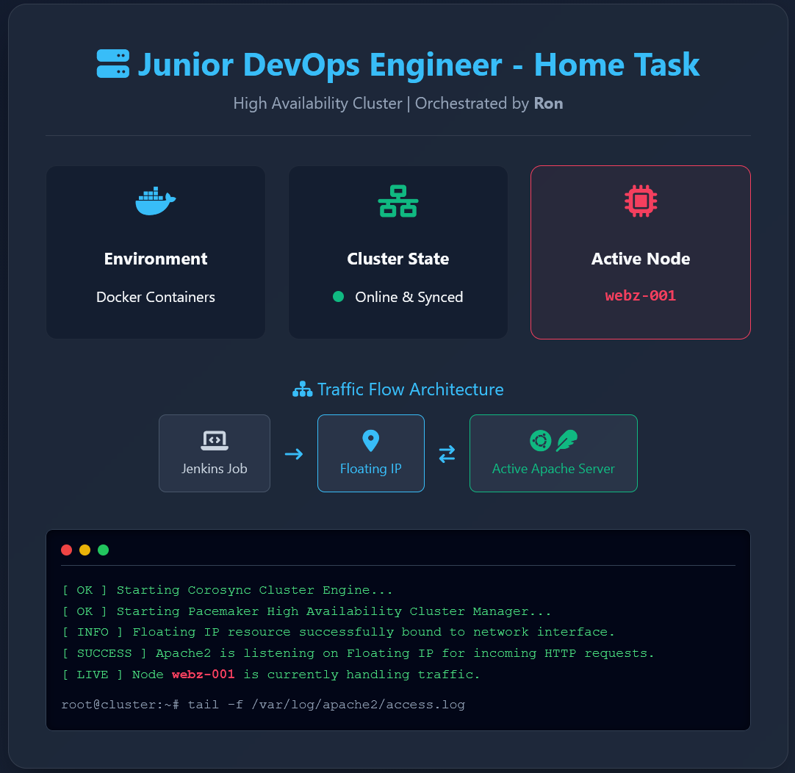
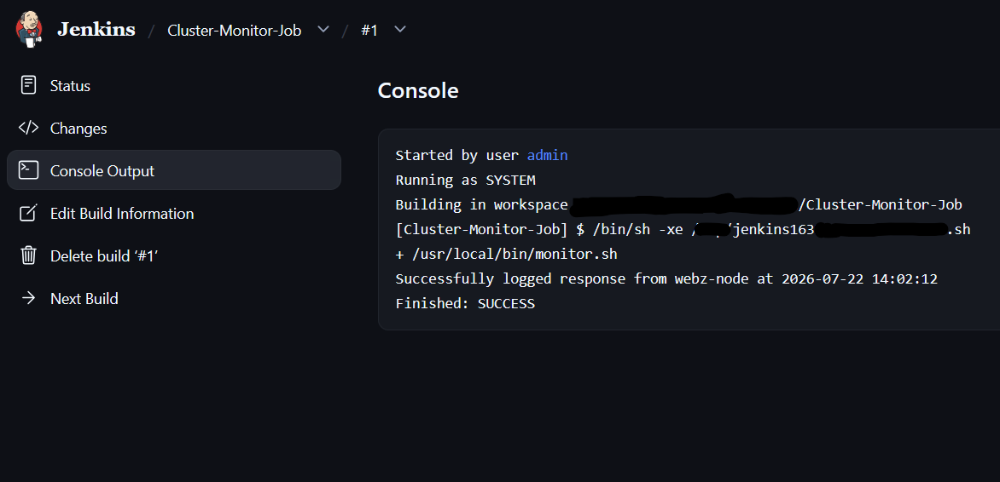
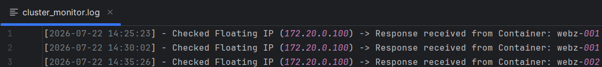

# 🚀 High-Availability (HA) Web Cluster & Automated Jenkins Monitoring

A resilient, multi-node High-Availability (HA) web cluster orchestrated with Docker, Apache, Floating IP management, and automated continuous health monitoring via Jenkins.

---

## 🏗️ Architecture Overview

The system consists of 4 Docker containers communicating across an isolated bridge network (`172.20.0.0/16`):

- **`webz-001`** (`172.20.0.11`) — Primary Active Node holding the Floating IP (`172.20.0.100`).
- **`webz-002`** (`172.20.0.12`) — Standby / Failover Cluster Node.
- **`webz-003`** (`172.20.0.13`) — Standby / Failover Cluster Node.
- **`webz-004`** (`172.20.0.14`) — Jenkins Server running automated healthchecks every 5 minutes.

---

## 📸 Visual Proof & System Screenshots

### 1. Web Dashboard (Dark Mode Status UI)


### 2. Jenkins Automated Monitoring Job


### 3. Log Verification (Proof of Failover from webz-001 to webz-002)


---

## 🚀 Quick Start & Deployment

### Prerequisites
- Docker & Docker Compose installed.
- Open ports: `8080` (Jenkins), `8081` (`webz-001`), `8082` (`webz-002`), `8083` (`webz-003`).

### 1. Build & Run the Environment
Run the following command in the project root directory:

```bash
docker compose up -d --build
```

### 2. Verify Running Containers
```bash
docker ps
```

---

## 🌐 Web Dashboards & Port Access

- **`webz-001` Status UI:** `http://localhost:8081`
- **`webz-002` Status UI:** `http://localhost:8082`
- **`webz-003` Status UI:** `http://localhost:8083`
- **Jenkins Server:** `http://localhost:8080`

---

## ⚙️ Jenkins Monitoring Setup

1. **Retrieve Initial Admin Password:**
   ```bash
   docker exec webz-004 cat /var/jenkins_home/secrets/initialAdminPassword
   ```

2. **Access Jenkins UI:** 
   Navigate to `http://localhost:8080` and log in.

3. **Create Monitoring Job:**
   - Click **New Item** -> Name it `Cluster-Monitor-Job` -> Select **Freestyle project**.
   - Under **Build Triggers**, check **Build periodically** and enter:
     ```text
     H/5 * * * *
     ```
   - Under **Build Steps**, add **Execute shell** and enter:
     ```bash
     /usr/local/bin/monitor.sh
     ```
   - Save and click **Build Now** to execute the initial run.

4. **Persistent Logs:**
   Logs are saved persistently on the host machine in `./logs/cluster_monitor.log`.

---

## 🧪 Failover Testing & Investigation

### Step 1: Simulate Primary Node Crash
Stop the active cluster container holding the Floating IP:
```bash
docker stop webz-001
```

### Step 2: Transfer Floating IP to Backup Node
In standard containerized environments without native systemd kernel triggers, manual VIP migration ensures immediate recovery to the active standby node:
```bash
docker exec -it webz-002 ip addr add 172.20.0.100/16 dev eth0
```

### Step 3: Verify Failover via Jenkins Logs
Trigger the Jenkins job manually or wait for the 5-minute schedule, then inspect `./logs/cluster_monitor.log`:
```text
Successfully logged response from webz-001 at 2026-07-22 14:24:30
Successfully logged response from webz-002 at 2026-07-22 14:35:26
```

---

## 💡 System Optimization & Future Improvements

1. **Keepalived (VRRP Protocol):**
   Using Keepalived instead of Pacemaker in containerized setups offers lightweight, native Virtual IP failover without requiring elevated Linux capabilities (`SYS_ADMIN`).

2. **Automated VRRP Healthchecks:**
   Attach dynamic script probes to monitor Apache service status continuously and automate VIP migration upon service failure.

3. **Frontend Load Balancer (HAProxy / NGINX):**
   Deploy an NGINX or HAProxy container in front of the web cluster to distribute traffic while maintaining redundancy.

4. **Centralized Structured Logging:**
   Format logs into JSON to enable seamless integration with ELK Stack (Elasticsearch, Logstash, Kibana) or Prometheus/Grafana.